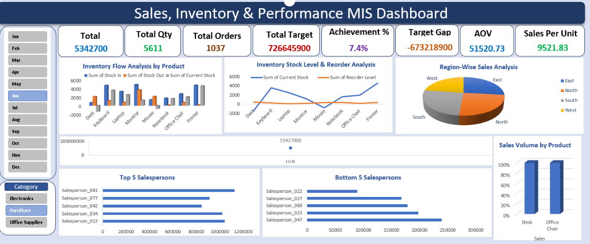

# Sales, Inventory & Performance MIS Dashboard

An Excel-based management information system (MIS) dashboard for reviewing sales, target attainment, inventory, and salesperson performance across 2025.



## What’s included

- **Interactive dashboard:** headline sales and order KPIs, target achievement, inventory analysis, regional sales, product volume, and top and bottom salesperson views. Use the month and category filters to explore the dashboard.
- **Monthly MIS summary:** monthly sales, quantity, orders, targets, achievement, target gap, and average order value.
- **Regional sales summary:** sales, quantity, orders, sales mix, and average order value by region.
- **Salesperson performance:** supporting performance view in the Excel workbook.
- **Source data:** CSV files used for sales, targets, inventory, and employee/region mapping.

## Output previews

### Monthly summary


### Regional summary


## Source data

| File | Contents |
| --- | --- |
| `Sales.csv` | 50,000 transaction rows with date, invoice, product, category, region, salesperson, quantity, unit price, and sales amount. |
| `Target.csv` | 1,200 monthly salesperson target records. |
| `Inventory.csv` | Stock-in, stock-out, current-stock, and reorder-level data for 8 products. |
| `Employee_Master.csv` | 100 employee records with department, manager, and region fields. Names use sample salesperson identifiers. |

## Repository layout

```text
01_Source_Data/
  Employee_Master.csv
  Inventory.csv
  Sales.csv
  Target.csv
02_Final_Output/
  Dashboard.png
  Monthly Summary.png
  Regional Sales Summary.png
  Sales, Inventory & Performance MIS Dashboard.xlsx
```

## Using the workbook

Open [`Sales, Inventory & Performance MIS Dashboard.xlsx`](02_Final_Output/Sales%2C%20Inventory%20%26%20Performance%20MIS%20Dashboard.xlsx) in Excel. Use the dashboard’s month and category filters, then refer to the monthly, regional, and salesperson views for supporting detail. The PNG files are static previews of the workbook outputs.
